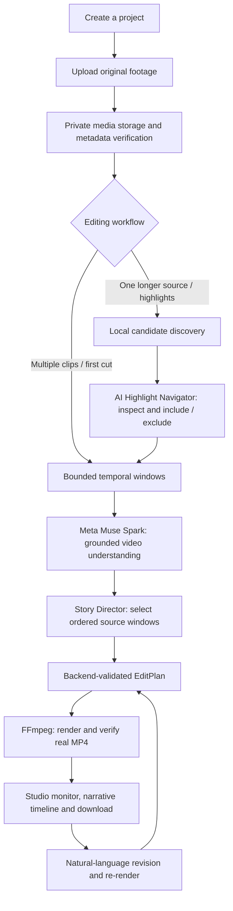

# IntentCut — Your AI Storytelling Director

**Turn raw footage into an explainable first cut, refine it with natural language, and export a real video.**

IntentCut is a local-first, AI-assisted video editing studio built for the **Meta Global AI Developer Hackathon 2026 — Indie Developer Track**. Instead of asking creators to review every second of raw footage and manually assemble an initial timeline, IntentCut uses **Meta Muse Spark** to understand sampled video moments, propose a grounded story structure, and collaborate with the creator on an editable result.

**The promise is a useful first cut—not a replacement for a professional editor or a guarantee of a publish-ready film.** Creators stay in control of selection, revision, captions, and the final export.

> **Hackathon submission** · Built during October 26–November 4, 2026 · Solo developer: [Jordan Arya Leksana](https://github.com/JordanAryaLeksana)
>
> **3-minute demo video:** _Add the public or unlisted, reviewer-accessible demo link before submission._  
> **Source code:** https://github.com/JordanAryaLeksana/intentcut  
> **Submission portal:** https://cerebralvalley.ai/e/meta-ai-developer-hackathon/hackathon/submit

**Jump to:** [How it works](#see-the-workflow) · [Features](#what-works-in-the-mvp) · [Meta AI](#how-meta-ai-is-used) · [Local setup](#quick-start--local-development) · [Testing](#validation-and-reproducibility) · [Judge's guide](#judges-guide-what-to-look-for) · [Submission checklist](#hackathon-submission-checklist)

## Why IntentCut?

For travel creators, solo filmmakers, educators, and anyone with a folder of unedited clips, the hardest part often comes **before** fine-grained editing: deciding which moments matter, what order they belong in, and how to turn them into a coherent story.

IntentCut addresses that first-cut bottleneck by combining AI editorial reasoning with deterministic media processing:

- **Understand:** analyze bounded video windows with Muse Spark rather than merely interpreting filenames or a text prompt.
- **Direct:** suggest a storyboard with source-grounded cut selections and a creator-specified narrative intent.
- **Inspect:** expose selected moments and original timestamps so a creator can make informed decisions.
- **Refine:** accept natural-language changes and maintain an editable, persisted editing workflow.
- **Deliver:** render and validate an actual H.264/AAC MP4 with FFmpeg, not a simulated preview.

The project's hackathon theme is **Build for Your World**: reducing the technical and creative friction between capturing footage and telling a story.

## See the workflow



**Key architectural distinction:** local highlight discovery uses bounded visual heuristics to propose *candidate* intervals; Muse Spark supplies semantic understanding and editorial selection. Candidate heuristic scores are **not** model confidence scores. Source timestamps remain authoritative throughout planning and rendering.

## What works in the MVP

| Capability | What it does | Evidence / scope |
| --- | --- | --- |
| Project and media library | Create projects, upload and persist source footage | Backend integration-tested |
| AI first-cut director | Interpret sampled windows and build a grounded sequence from one or more clips | End-to-end orchestration tested with mocked Muse responses |
| Smart long-form highlights | Discover bounded candidates from one source, preview, include/exclude, and submit AUTO or GUIDED intent | Real browser/backend/worker/FFmpeg tested with mocked Muse responses |
| AI Highlight Navigator | Show source-relative markers, previews, source intervals, and editorial controls inside the existing cinematic Studio | Browser interaction tested; not a separate editor |
| Narrative timeline and program monitor | Display saved editing decisions and rendered output | Integrated with the existing editing workflow |
| Conversational revisions | Propose and accept changes to an existing cut, then re-render | Real-MP4 regression tests |
| Captions | Edit persisted captions and export a subtitled version | Real FFmpeg burn-in tests; transcription provider is a separate opt-in |
| AI Visuals | Generate/edit visual assets and select a project cover | Persisted API workflow; external provider mocked in automated tests |
| Real export | Publish a downloadable H.264 MP4 with AAC audio | FFprobe, full decode, frame ordering and source integrity checks |

**Not a claim of:** unrestricted six-hour uploads, guaranteed semantically optimal highlights, full non-linear editing parity, or public multi-user SaaS readiness. See [Limitations](#limitations-and-security) below.

## How Meta AI is used

This is more than a generic chatbot attached to a timeline.

1. **Muse Spark — video understanding:** the worker extracts short, bounded temporal windows from the creator's actual footage. Muse receives those clips and returns structured understanding evidence.
2. **Muse Spark — editorial decision-making:** the Story Director consumes that evidence and the user's creative brief, then selects grounded **window indices**, source media references, and playback order.
3. **Deterministic safety boundary:** the backend—not the model—owns file identities, original timestamps, budgets, EditPlan validation, source fingerprints, and final media rendering. Invalid or invented references are rejected.
4. **Muse Image — optional creative assets:** a separate workflow can generate/edit project visuals and persist cover selection. This does not replace the original video source.
5. **Human-in-the-loop editing:** creators can inspect candidates, guide editorial intent, exclude unwanted moments, and revise the result.

Meta API calls occur in the **background worker**, not in HTTP request handlers. The automated acceptance tests mock the **external Muse provider boundary**, while exercising the real database, orchestration, FFmpeg processes, artifact persistence, and download path. A live-model demo is a separate verification step; mocked tests do not establish real-world editorial quality.

## Architecture and engineering decisions

| Layer | Technology / responsibility |
| --- | --- |
| Web studio | Next.js 16, React 19, TypeScript, Tailwind CSS, React Query, Zustand; cinematic Three.js landing |
| HTTP API | FastAPI and Pydantic: projects, media, jobs, highlights, editing, captions, artifacts |
| Persistence | PostgreSQL 17, SQLAlchemy, Psycopg; durable jobs, media references and editing state |
| AI orchestration | Meta Muse Spark via Meta Model API; bounded, structured and source-grounded inference |
| Media engine | FFmpeg / FFprobe: temporal extraction, normalization, caption burn-in, encoding and validation |
| Worker | Explicit job dispatch, database leases, heartbeat/recovery, bounded processing and artifact publication |
| Optional creative AI | Muse Image for image generation/editing and cover selection; voice transcription is separately configured |

```text
intentcut/
├── frontend/                 # Next.js Studio and landing page
├── src/intentcut/
│   ├── ai/                   # Muse integrations and Story Director
│   ├── backend/              # FastAPI, media, highlights, editing, workers
│   └── media/                # FFmpeg-backed rendering and probes
├── tests/
│   ├── unit/                 # Fast contract and behavior tests
│   └── integration/backend/  # DB, API, media and real-MP4 tests
├── scripts/                  # Development utilities
├── compose.yaml              # Local PostgreSQL services (NOT full-app Docker)
├── pyproject.toml / uv.lock   # Python package and locked dependencies
└── frontend/package-lock.json
```

The architecture separates **model decisions** from **media authority**: Muse can recommend a sequence, but only validated source intervals from registered media can be rendered. Source inputs are preserved, published artifacts are checked for integrity, and job processing is recoverable within defined limits.

## Quick start — local development

> **Important:** the supported deployment posture is **trusted local development**. The backend has no end-user authentication or per-user authorization and must **not** be exposed to the public internet, a tunnel, or an untrusted LAN. For cross-platform guidance, see the next section.

### Prerequisites

- **Python 3.12.x** (the repo uses Python 3.12; `uv` can install the pinned interpreter).
- **uv** for Python dependencies ([installation guide](https://docs.astral.sh/uv/getting-started/installation/)).
- **Node.js 24** (used in development) and npm. Use `npm ci` against the existing lockfile.
- **Docker Engine/Desktop with Compose v2** to run the included PostgreSQL 17 service.
- **FFmpeg and FFprobe** on `PATH`, with H.264 `libx264`, AAC encoding, and the `scale` filter's `reset_sar` support. The media engine was validated with FFmpeg 8.0.1 on Ubuntu; other builds need local verification.
- **Meta Model API key** only for actual Muse-powered generation. Running frontend/build/offline tests does not authorize paid inference.

### 1 — Clone and configure

Run in a Linux, macOS, or **Windows WSL2 Ubuntu** terminal:

```bash
git clone https://github.com/JordanAryaLeksana/intentcut.git
cd intentcut
cp .env.example .env
```

Edit `.env` locally. Replace `CHANGE_ME` consistently in `POSTGRES_PASSWORD`, `DATABASE_URL`, and `TEST_DATABASE_URL`; replace the placeholder `MODEL_API_KEY` with your own credential **only if running live AI**. Never commit `.env` or paste API keys into issues or demo recordings.

For a local browser-based Studio, these values additionally need to be present in the root `.env`:

```dotenv
AI_JOBS_LOCAL_ENABLED=true
AI_JOBS_BROWSER_ENABLED=true
AI_PROCESSING_ENABLED=true
CORS_ORIGINS=["http://127.0.0.1:3000","http://localhost:3000"]
```

**Costs and security:** `AI_PROCESSING_ENABLED=true` permits job execution with a valid API key; an invoked worker can make billable Meta API requests. Keep processing disabled when not needed, and enable browser access only on loopback with the explicit allowed origins above. `MODEL_API_KEY` stays on the backend—never use a `NEXT_PUBLIC_` variable for it.

### 2 — Database and Python environment

```bash
docker compose up -d postgres
uv python install 3.12.15
uv sync --frozen
uv run intentcut-init-db
```

The Compose file publishes PostgreSQL **only on `127.0.0.1:5432`**. It does not build or launch the backend or frontend. Database initialization creates missing tables; it is not a general migration framework.

### 3 — Start the API (terminal A, from repository root)

```bash
uv run uvicorn intentcut.backend.app:create_app \
  --factory --host 127.0.0.1 --port 8000 --no-proxy-headers
```

Keep the backend bound to loopback. Swagger API reference is available at `http://127.0.0.1:8000/docs` while the server runs.

### 4 — Start the Studio (terminal B)

Create `frontend/.env.local` with:

```dotenv
NEXT_PUBLIC_API_BASE_URL=http://127.0.0.1:8000
```

Then run:

```bash
cd frontend
npm ci
npm run dev
```

Open **http://127.0.0.1:3000** in a modern desktop browser. Create a project, upload footage, and explore the existing Studio. The API URL is included in the client build, so **rebuild the frontend if you change `NEXT_PUBLIC_API_BASE_URL` for a production build**.

### 5 — Execute a queued AI job (terminal C, from repository root)

When a project has queued a job and the Meta key and opt-ins are configured:

```bash
uv run intentcut-ai-worker --max-jobs 1 --max-attempts 1
```

This intentionally processes **at most one queued job** and avoids automatic retry. For local development with an explicitly accepted ongoing inference cost, the worker also supports `--continuous --poll-seconds 3`. Do not start continuous paid processing by default for a judge's first run. Inspect the returned job status and rendered artifact in Studio.

**Alternative without a Meta key:** test the deterministic renderer directly (ensure the destination directory exists and the output does not already exist):

```bash
uv run intentcut-render path/to/first.mp4 path/to/second.mp4 -o output.mp4
```

This verifies the video engine, **not** AI editorial selection.

## Operating system and device guidance

The application targets standards-based browsers, but **installation**, **browser responsiveness**, and **remote-device networking** are different claims.

| Environment | Recommended approach | Validation status |
| --- | --- | --- |
| Ubuntu / Linux | Python/uv + FFmpeg installed locally; Docker Compose for PostgreSQL; Node/npm for frontend | **Primary development and E2E environment** |
| Windows 11 | **WSL2 Ubuntu** with Docker Desktop WSL integration; run the Linux instructions inside WSL | **Recommended compatibility route; not separately E2E-certified** |
| macOS (Apple Silicon / Intel) | Homebrew or equivalent for FFmpeg and uv, Python 3.12 via uv, Docker Desktop for PostgreSQL, Node/npm | **Expected from portable stack; verify FFmpeg features and run tests locally** |
| Windows native (PowerShell) | Not the primary tested environment; prefer WSL2 to avoid FFmpeg, path and shell differences | **Not validated** |
| Mobile / tablet browser | Responsive UI design is present, but local-only API networking prevents unsupported remote-device usage | **Layout viewport checks are not a guarantee of remote-phone E2E** |

The project is **not** a one-command Docker deployment across operating systems: `compose.yaml` currently runs PostgreSQL only. No universal OS/device compatibility claim is made.

**Platform-specific preparation:**

- **Ubuntu/Linux:** install Git and FFmpeg through your distribution's package manager (for example `sudo apt update && sudo apt install -y git ffmpeg` on Ubuntu). Install Docker Engine + Compose v2, Node.js 24, and `uv` using their official installation instructions. Distribution FFmpeg packages may differ from the validated 8.0.1 build.
- **macOS:** with [Homebrew](https://brew.sh/), `brew install git ffmpeg uv`; install Node.js 24 through your preferred version manager and Docker Desktop. Check the FFmpeg encoder/filter support before running the renderer.
- **Windows:** in an elevated PowerShell terminal use `wsl --install -d Ubuntu` where supported; restart if prompted, enable Docker Desktop's WSL2 integration, then use the Linux commands **inside Ubuntu**, preferably with the repo cloned to the Linux filesystem rather than a Windows-mounted directory.

**Troubleshooting:**

| Symptom | Check |
| --- | --- |
| API cannot connect to PostgreSQL | `docker compose ps`; match the `.env` password and `DATABASE_URL` to port `5432` |
| Studio says it cannot reach API | Confirm backend is running, `frontend/.env.local` uses `NEXT_PUBLIC_API_BASE_URL=http://127.0.0.1:8000`, and browser origin is listed in `CORS_ORIGINS`; restart frontend after changing client configuration |
| AI job remains queued | The backend does not process jobs itself. Start `intentcut-ai-worker` with the same root `.env` and inspect its output |
| AI job disabled / unavailable (`503`) | Verify local-only and processing opt-ins, API key availability and FFmpeg on `PATH`; do not bypass security middleware |
| Upload rejected (`413`) | Check both `MAX_FILE_BYTES` and `MAX_REQUEST_BYTES`; increasing them requires free disk and explicit testing |
| FFmpeg cannot encode | Check `libx264`, AAC, and `scale/reset_sar`; use a compatible system FFmpeg build |
| Test DB connectivity errors | Bring up `postgres-test` and check `TEST_DATABASE_URL` points to `intentcut_test` on port `5433`, not the primary database |

If `ffmpeg` is missing or produces a filter/encoder error, run:

```bash
ffmpeg -version
ffprobe -version
ffmpeg -h filter=scale
ffmpeg -encoders
```

Verify the expected codecs and `reset_sar` option before processing footage.

## Validation and reproducibility

Run from the repository root after configuring the dedicated **test** database:

```bash
docker compose --profile test up -d postgres-test
uv run --env-file .env pytest tests/unit/ -q
uv run --env-file .env pytest tests/integration/backend/ -q
uv run ruff check .
uv run ruff format --check .
```

Frontend validation:

```bash
cd frontend
npm ci
npm run build
npm run test:api
npm run test:media
npm run test:storyboard
npm run test:timeline
npm run test:highlights
npm run test:highlights-nav
```

**Reported local validation snapshot (November 3, 2026, on the final-submission-audit branch):** 479 unit tests passed; 264 backend integration tests passed; the frontend production build passed in its preceding release audit. These are developer-reported local results, **not a claimed public CI badge**. The full browser → worker → MP4 path was exercised with a local deterministic **mock Muse provider**; the downloaded MP4 was probed and fully decoded. Real Muse inference and a six-hour/multi-GB file are separate acceptance gates.

Integration tests require `TEST_DATABASE_URL` to point to a dedicated database ending in `_test` (the included Compose test service maps it to `127.0.0.1:5433`). They generate synthetic media and may invoke real FFmpeg. **Never point tests at a production database.**

## Limitations and security

- **Local-first, not public SaaS:** project/media routes do not implement user authentication or authorization; AI routes use a configurable local-only guard. Do not expose this service publicly or treat loopback protection as user authentication.
- **Ingestion limits:** the default upload cap is **128 MiB per file**, with an overall request limit of **512 MiB**. Highlight analysis has separate budgets; changing one limit does not automatically raise the others.
- **Long footage:** the highlight architecture represents original timestamps up to six hours and uses bounded candidate sampling, but actual six-hour and multi-gigabyte upload/render performance **has not been validated**.
- **Bounded inference:** the default AI path is limited to 12 analyzed windows / 13 inference calls per attempt. Long-form discovery chooses candidates; it does not semantically analyze every frame in a six-hour recording.
- **AI quality:** heuristic candidate scores measure inexpensive image properties; live semantic selection is model-dependent and may require creator judgment. Provider calls require an active API key and may incur charges.
- **Media constraints:** FFmpeg software encoding, intermediate files, and full output validation require available CPU and disk space. Unsupported media formats and invalid durations fail validation rather than silently exporting a broken video.
- **Editing scope:** IntentCut is an explainable first-cut copilot. It does not aim to replace a professional non-linear editing suite with arbitrary effects, collaborative multi-user access, or guaranteed production-quality edits.
- **Footage rights:** upload only footage you own or are authorized to reuse. A publicly viewable video is not automatically licensed for editing, redistribution, or a hackathon demonstration.

## Judge's guide: what to look for

The following capabilities map to the hackathon's published criteria without claiming unearned outcomes.

| Judging criterion | What IntentCut demonstrates |
| --- | --- |
| **Impact (30%)** | Helps creators move from raw footage to a usable first cut, especially when manual review and moment selection are expensive in time |
| **Use of Meta AI Tooling (25%)** | Muse Spark understanding of actual video windows + source-grounded editorial direction; optional Muse Image creative assets; AI suggestions remain bounded and explainable |
| **Technical Depth & Execution (20%)** | Validated EditPlans, immutable source references, explicit inference budgets, PostgreSQL worker lifecycle, robust FFmpeg output validation and real-MP4 tests |
| **Demo (25%)** | A reproducible flow: create → upload → generate → inspect storyboard / highlights → revise → play and download real MP4 |

### Suggested three-minute demo

| Time | Show | What the judge learns |
| --- | --- | --- |
| **0:00–0:20** | The raw-footage problem and IntentCut's one-sentence promise | Intended user and impact |
| **0:20–0:45** | Create project and upload licensed source footage | Real application and input |
| **0:45–1:20** | Enter a creative brief; show Muse-powered window understanding and storyboard | Real Meta AI use and grounded decisions |
| **1:20–1:50** | Inspect Highlight Navigator, original timestamps and include/exclude | Human control and explainability |
| **1:50–2:25** | Show real MP4, timeline, and one accepted natural-language revision | Working editing loop and technical execution |
| **2:25–3:00** | Download/play export; briefly show relevant code/tests and honest MVP limitations | Functionality, engineering quality, transparency |

**Demo integrity:** show real recorded interactions and clearly distinguish *live Muse inference* from a deterministic or mocked demonstration. Include specific code and functionality built during the hackathon. Keep the video **at or under three minutes**, and confirm the link works in an incognito window.

## Hackathon submission checklist

- [ ] Repository is public and opens in a logged-out browser.
- [ ] The **three-minute demo video** is accessible without requesting permission.
- [ ] Demo explicitly shows the code, features, and real functionality built during October 26–November 4, 2026.
- [ ] Submit through [Cerebral Valley](https://cerebralvalley.ai/e/meta-ai-developer-hackathon/hackathon/submit) **before November 4, 2026 at 9:00 PM EST** (November 5, 09:00 WIB).
- [ ] Solo-builder / contributor information on the submission matches the actual project participants.
- [ ] All real API credentials, `.env` files, generated artifacts containing private footage, and unnecessary local state are excluded from Git.
- [ ] Submission repo is built from the intended final branch and linked to the correct demo version.
- [ ] Any optional X post or category entry is completed only if you actually enter that award category.

## Related technical documentation

The repository preserves implementation notes and acceptance evidence from individual milestones. Start here for deeper inspection:

- [Uploaded media → Muse → worker → MP4](M2B9_UPLOADED_MEDIA.md)
- [Job API and local access boundary](M2B8_API.md)
- [Editable captions](BATCH_4_EDITABLE_CAPTIONS.md)
- [Muse Image / AI Visuals](BATCH_5_MUSE_IMAGE.md)
- [Persistent editing](M3_4_PERSISTENT_EDITING.md)
- [Collaborative revisions](M3_5_COLLABORATIVE_REVISION.md)
- [Engineering conventions](AGENTS.md)

Some milestone documents describe historical states and may be superseded by the current code. **The source code and current tests are authoritative** for behavior.

---

**Built by [Jordan Arya Leksana](https://github.com/JordanAryaLeksana) · Meta Global AI Developer Hackathon 2026 · Indie Developer Track**

*IntentCut: AI proposes the story. The creator directs it. FFmpeg makes it real.*
