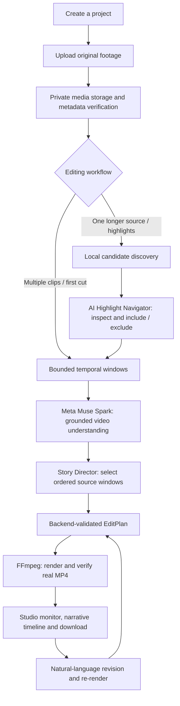

# IntentCut — Your AI Storytelling Director

**Turn raw footage into an explainable first cut, refine it with natural language, and export a real video.**

IntentCut is a local-first, AI-assisted video editing studio built for the **Meta Global AI Developer Hackathon 2026 — Indie Developer Track**. Instead of asking creators to review every second of raw footage and manually assemble an initial timeline, IntentCut uses **Meta Muse Spark** to understand sampled video moments, propose a grounded story structure, and collaborate with the creator on an editable result.

**The promise is a useful first cut—not a replacement for a professional editor or a guarantee of a publish-ready film.** Creators stay in control of selection, revision, captions, and the final export.

> **Hackathon submission** · Built during October 26–November 4, 2026 · Solo developer: [Jordan Arya Leksana](https://github.com/JordanAryaLeksana)
>
> **3-minute demo video:** _Add the public or unlisted, reviewer-accessible demo link before submission._  
> **Source code:** https://github.com/JordanAryaLeksana/intentcut  
> **Submission portal:** https://cerebralvalley.ai/e/meta-ai-developer-hackathon/hackathon/submit

**Jump to:** [How it works](#see-the-workflow) · [Features](#what-works-in-the-mvp) · [Meta AI](#how-meta-ai-is-used) · [Local setup](#quick-start--local-development) · [Testing](#validation-and-reproducibility) · [Judge's guide](#judges-guide-what-to-look-for) · [Submission checklist](#hackathon-submission-checklist)

## Why IntentCut?

For travel creators, solo filmmakers, educators, and anyone with a folder of unedited clips, the hardest part often comes **before** fine-grained editing: deciding which moments matter, what order they belong in, and how to turn them into a coherent story.

IntentCut addresses that first-cut bottleneck by combining AI editorial reasoning with deterministic media processing:

- **Understand:** analyze bounded video windows with Muse Spark rather than merely interpreting filenames or a text prompt.
- **Direct:** suggest a storyboard with source-grounded cut selections and a creator-specified narrative intent.
- **Inspect:** expose selected moments and original timestamps so a creator can make informed decisions.
- **Refine:** accept natural-language changes and maintain an editable, persisted editing workflow.
- **Deliver:** render and validate an actual H.264/AAC MP4 with FFmpeg, not a simulated preview.

The project's hackathon theme is **Build for Your World**: reducing the technical and creative friction between capturing footage and telling a story.

## See the workflow



**Key architectural distinction:** local highlight discovery uses bounded visual heuristics to propose *candidate* intervals; Muse Spark supplies semantic understanding and editorial selection. Candidate heuristic scores are **not** model confidence scores. Source timestamps remain authoritative throughout planning and rendering.

## What works in the MVP

| Capability | What it does | Evidence / scope |
| --- | --- | --- |
| Project and media library | Create projects, upload and persist source footage | Backend integration-tested |
| AI first-cut director | Interpret sampled windows and build a grounded sequence from one or more clips | End-to-end orchestration tested with mocked Muse responses |
| Smart long-form highlights | Discover bounded candidates from one source, preview, include/exclude, and submit AUTO or GUIDED intent | Real browser/backend/worker/FFmpeg tested with mocked Muse responses |
| AI Highlight Navigator | Show source-relative markers, previews, source intervals, and editorial controls inside the existing cinematic Studio | Browser interaction tested; not a separate editor |
| Narrative timeline and program monitor | Display saved editing decisions and rendered output | Integrated with the existing editing workflow |
| Conversational revisions | Propose and accept changes to an existing cut, then re-render | Real-MP4 regression tests |
| Captions | Edit persisted captions and export a subtitled version | Real FFmpeg burn-in tests; transcription provider is a separate opt-in |
| AI Visuals | Generate/edit visual assets and select a project cover | Persisted API workflow; external provider mocked in automated tests |
| Real export | Publish a downloadable H.264 MP4 with AAC audio | FFprobe, full decode, frame ordering and source integrity checks |

**Not a claim of:** unrestricted six-hour uploads, guaranteed semantically optimal highlights, full non-linear editing parity, or public multi-user SaaS readiness. See [Limitations](#limitations-and-security) below.

## How Meta AI is used

This is more than a generic chatbot attached to a timeline.

1. **Muse Spark — video understanding:** the worker extracts short, bounded temporal windows from the creator's actual footage. Muse receives those clips and returns structured understanding evidence.
2. **Muse Spark — editorial decision-making:** the Story Director consumes that evidence and the user's creative brief, then selects grounded **window indices**, source media references, and playback order.
3. **Deterministic safety boundary:** the backend—not the model—owns file identities, original timestamps, budgets, EditPlan validation, source fingerprints, and final media rendering. Invalid or invented references are rejected.
4. **Muse Image — optional creative assets:** a separate workflow can generate/edit project visuals and persist cover selection. This does not replace the original video source.
5. **Human-in-the-loop editing:** creators can inspect candidates, guide editorial intent, exclude unwanted moments, and revise the result.

Meta API calls occur in the **background worker**, not in HTTP request handlers. The automated acceptance tests mock the **external Muse provider boundary**, while exercising the real database, orchestration, FFmpeg processes, artifact persistence, and download path. A live-model demo is a separate verification step; mocked tests do not establish real-world editorial quality.

## Architecture and engineering decisions

| Layer | Technology / responsibility |
| --- | --- |
| Web studio | Next.js 16, React 19, TypeScript, Tailwind CSS, React Query, Zustand; cinematic Three.js landing |
| HTTP API | FastAPI and Pydantic: projects, media, jobs, highlights, editing, captions, artifacts |
| Persistence | PostgreSQL 17, SQLAlchemy, Psycopg; durable jobs, media references and editing state |
| AI orchestration | Meta Muse Spark via Meta Model API; bounded, structured and source-grounded inference |
| Media engine | FFmpeg / FFprobe: temporal extraction, normalization, caption burn-in, encoding and validation |
| Worker | Explicit job dispatch, database leases, heartbeat/recovery, bounded processing and artifact publication |
| Optional creative AI | Muse Image for image generation/editing and cover selection; voice transcription is separately configured |

```text
intentcut/
├── frontend/                 # Next.js Studio and landing page
├── src/intentcut/
│   ├── ai/                   # Muse integrations and Story Director
│   ├── backend/              # FastAPI, media, highlights, editing, workers
│   └── media/                # FFmpeg-backed rendering and probes
├── tests/
│   ├── unit/                 # Fast contract and behavior tests
│   └── integration/backend/  # DB, API, media and real-MP4 tests
├── scripts/                  # Development utilities
├── compose.yaml              # Local PostgreSQL services (NOT full-app Docker)
├── pyproject.toml / uv.lock   # Python package and locked dependencies
└── frontend/package-lock.json
```

The architecture separates **model decisions** from **media authority**: Muse can recommend a sequence, but only validated source intervals from registered media can be rendered. Source inputs are preserved, published artifacts are checked for integrity, and job processing is recoverable within defined limits.

## Quick start — local development

> **Security notice:** IntentCut currently supports trusted, local-first development. The backend does not implement end-user authentication or per-user authorization. Do not expose its API to the public internet, an untrusted LAN, or a public tunnel. UUIDs and project slugs are not access controls.

### Prerequisites

- **Python 3.12.x** and [uv](https://docs.astral.sh/uv/getting-started/installation/)
- **Node.js 24** and npm
- **Docker Engine/Desktop** with Docker Compose v2
- **PostgreSQL 17**, provided through Docker Compose
- **FFmpeg and FFprobe**, with H.264 (`libx264`) and AAC encoding support
- **Meta Model API key**, required only for live Muse-powered processing

The primary validated environment is Ubuntu Linux with Python 3.12, Node.js 24, PostgreSQL 17, and FFmpeg 8.0.1.

### 1. Clone and configure

```bash
git clone https://github.com/JordanAryaLeksana/intentcut.git
cd intentcut
cp .env.example .env
```

Edit `.env` locally. Configure `POSTGRES_PASSWORD`, `DATABASE_URL`, and `TEST_DATABASE_URL` consistently with the PostgreSQL services.

For local browser-based Studio access, configure the following settings:

```dotenv
AI_JOBS_LOCAL_ENABLED=true
AI_JOBS_BROWSER_ENABLED=true
AI_PROCESSING_ENABLED=false
CORS_ORIGINS='["http://127.0.0.1:3000","http://localhost:3000"]'
```

Set `AI_PROCESSING_ENABLED=true` only when you intend to execute AI jobs. Configure `MODEL_API_KEY` with a valid credential before starting live Muse processing.

**Never commit `.env`, expose API credentials in frontend environment variables, or include secrets in demo recordings.**

### 2. Start PostgreSQL and install Python dependencies

```bash
docker compose up -d postgres
docker compose ps

uv python install 3.12.15
uv sync --frozen
```

Initialize the database:

```bash
uv run --env-file .env intentcut-init-db
```

The PostgreSQL application service is published on `127.0.0.1:5432`.

Docker Compose starts the database service, not the complete IntentCut application.

**Important:** Database initialization creates missing tables but does not migrate existing tables to newer schemas.

### 3. Database migrations for existing installations

If you are upgrading an existing IntentCut database, inspect the SQL migrations under:

```text
scripts/migrations/
```

Migration files are versioned and should be applied in the required sequence, based on the current database schema.

For example, migration `007_project_slugs.sql` adds and backfills readable project slugs while retaining existing project UUIDs.

Before applying any migration:

1. Back up the application database.
2. Review the migration SQL and confirm the target database.
3. Stop concurrent writes.
4. Execute the applicable migration transactionally.
5. Verify the resulting schema and API behavior.

The following example applies **migration 007 only**, assuming earlier migrations have already been applied and the PostgreSQL container is configured for the `intentcut` application database.

Create a backup:

```bash
mkdir -p .local-backups
chmod 700 .local-backups

docker compose exec -T postgres \
  sh -c 'exec pg_dump -U "$POSTGRES_USER" -d "$POSTGRES_DB" -Fc' \
  > .local-backups/intentcut-before-007.dump
```

Verify the backup archive:

```bash
docker compose exec -T postgres pg_restore -l \
  < .local-backups/intentcut-before-007.dump
```

Apply the migration:

```bash
{
  printf 'BEGIN;\n'
  cat scripts/migrations/007_project_slugs.sql
  printf '\nCOMMIT;\n'
} | docker compose exec -T postgres \
  sh -c 'exec psql -X -v ON_ERROR_STOP=1 -U "$POSTGRES_USER" -d "$POSTGRES_DB"'
```

After a successful commit, verify the application endpoint:

```bash
curl -i http://127.0.0.1:8000/projects
```

Run this HTTP check after starting the API in the next step. A successful request should return HTTP `200`.

Do not delete existing PostgreSQL volumes to resolve schema mismatches.

### 4. Start the backend API

From the repository root:

```bash
uv run --env-file .env uvicorn intentcut.backend.app:create_app \
  --factory \
  --host 127.0.0.1 \
  --port 8000 \
  --no-proxy-headers
```

The API will be accessible at:

- API documentation: `http://127.0.0.1:8000/docs`
- Projects endpoint: `http://127.0.0.1:8000/projects`

If port `8000` is already occupied, use another available loopback port and update the frontend API URL accordingly.

**Keep the backend bound to `127.0.0.1`.**

### 5. Start the frontend Studio

Create `frontend/.env.local`:

```dotenv
NEXT_PUBLIC_API_BASE_URL=http://127.0.0.1:8000
```

Then run:

```bash
cd frontend
npm ci
npm run dev
```

Open `http://127.0.0.1:3000`.

Create a project, upload authorized footage, and enter the editing Studio.

If port `3000` is occupied, start Next.js on another port:

```bash
npm run dev -- --hostname 127.0.0.1 --port 3001
```

When changing the frontend port, add the corresponding origin to `CORS_ORIGINS` and restart the backend. Restart the frontend after changing its API configuration.

### 6. Execute one queued AI job

Before running live AI processing:

- Configure a valid `MODEL_API_KEY`.
- Set `AI_PROCESSING_ENABLED=true`.
- Restart the backend if its configuration changed.
- Ensure the worker uses the same database configuration.
- Confirm which job is queued to avoid unintended API charges.

From the repository root:

```bash
uv run --env-file .env intentcut-ai-worker --max-jobs 1
```

This limits execution to at most one job in the worker invocation. Check `intentcut-ai-worker --help` for additional supported retry and scheduling options.

The worker performs AI processing separately from HTTP requests. Successful processing should produce persisted editing artifacts and a rendered video that can be inspected and downloaded through Studio.

**Live Muse inference may incur API charges.** Avoid continuous processing or automatic retries unless explicitly intended.

### 7. Verify deterministic video rendering

Without a Meta API key, the FFmpeg-based renderer can be exercised independently:

```bash
uv run intentcut-render \
  path/to/first.mp4 \
  path/to/second.mp4 \
  -o output.mp4
```

Provide existing, supported input media and a valid output path.

This verifies deterministic media rendering, **not Muse Spark video understanding or editorial reasoning**.

---

## Operating system and device guidance

IntentCut primarily targets local development and desktop-browser editing. Cross-platform compatibility should be distinguished from actual end-to-end validation.

| Environment | Guidance | Validation |
| --- | --- | --- |
| Ubuntu/Linux | Python, uv, FFmpeg, Node.js, and Docker Compose | Primary tested environment |
| Windows 11 | Use WSL2 Ubuntu with Docker Desktop integration | Recommended; not separately E2E-certified |
| macOS | Install dependencies using Homebrew or equivalent | Expected compatibility; requires verification |
| Native Windows | Prefer WSL2 for consistent shell, path, and FFmpeg behavior | Not validated |
| Mobile/tablet browsers | Responsive interface available; local-only API networking limits remote-device access | Viewport tests do not establish device E2E |

The provided `compose.yaml` runs PostgreSQL services. It does not provide a universal one-command deployment of the complete application.

### Troubleshooting

| Problem | Recommended check |
| --- | --- |
| API returns `database_unavailable` | Confirm database connection, inspect SQLAlchemy logs, and verify migrations |
| `column projects.slug does not exist` | Review and apply migration 007 after a verified backup |
| Browser returns CORS errors | Check the exact frontend origin in `CORS_ORIGINS` and restart the API |
| Studio cannot connect to the API | Verify Uvicorn port and `NEXT_PUBLIC_API_BASE_URL` |
| AI job remains queued | Check worker execution, feature flags, and database configuration |
| Upload returns HTTP 413 | Inspect upload and request-size limits |
| FFmpeg rendering fails | Check codecs, filters, source format, and available disk space |

Useful diagnostics:

```bash
docker compose ps
ffmpeg -version
ffprobe -version
ffmpeg -h filter=scale
ffmpeg -encoders
```

---

## Validation and reproducibility

### Backend tests

Start the dedicated test database:

```bash
docker compose --profile test up -d postgres-test
```

Run the automated tests:

```bash
uv run --env-file .env pytest tests/unit/ -q
uv run --env-file .env pytest tests/integration/backend/ -q
uv run ruff check .
uv run ruff format --check .
```

The test database must be isolated from the application database. Never run integration tests against a production database.

### Frontend validation

```bash
cd frontend

npm ci
npm run build

npm run test:api
npm run test:media
npm run test:storyboard
npm run test:timeline
npm run test:highlights
npm run test:highlights-nav
```

### Reported verification results

On November 3, 2026, the final-submission audit reported:

- **479 passing unit tests**
- **264 passing backend integration tests**
- Successful Next.js production build
- Real FFmpeg-based MP4 generation and validation
- Browser-to-worker workflows tested using a deterministic mock Muse provider

These are local developer-reported results, not a public CI certification.

**Mocked Muse provider tests and live Muse inference are separate verification levels.** Automated tests validate orchestration, data persistence, and media rendering without establishing the semantic quality of real-model editorial decisions.

Actual live inference outcomes should be documented separately after verification.

## Limitations and security

- **Local-first, not public SaaS:** project/media routes do not implement user authentication or authorization; AI routes use a configurable local-only guard. Do not expose this service publicly or treat loopback protection as user authentication.
- **Ingestion limits:** the default upload cap is **128 MiB per file**, with an overall request limit of **512 MiB**. Highlight analysis has separate budgets; changing one limit does not automatically raise the others.
- **Long footage:** the highlight architecture represents original timestamps up to six hours and uses bounded candidate sampling, but actual six-hour and multi-gigabyte upload/render performance **has not been validated**.
- **Bounded inference:** the default AI path is limited to 12 analyzed windows / 13 inference calls per attempt. Long-form discovery chooses candidates; it does not semantically analyze every frame in a six-hour recording.
- **AI quality:** heuristic candidate scores measure inexpensive image properties; live semantic selection is model-dependent and may require creator judgment. Provider calls require an active API key and may incur charges.
- **Media constraints:** FFmpeg software encoding, intermediate files, and full output validation require available CPU and disk space. Unsupported media formats and invalid durations fail validation rather than silently exporting a broken video.
- **Editing scope:** IntentCut is an explainable first-cut copilot. It does not aim to replace a professional non-linear editing suite with arbitrary effects, collaborative multi-user access, or guaranteed production-quality edits.
- **Footage rights:** upload only footage you own or are authorized to reuse. A publicly viewable video is not automatically licensed for editing, redistribution, or a hackathon demonstration.

## Technical implementation and verification

IntentCut's main capabilities are implemented and verifiable through the application source code and automated tests:

- **Media ingestion and AI orchestration:** Project creation, footage uploads, temporal video analysis with Muse Spark, AI job processing, and validated edit plans.
- **Video rendering:** FFmpeg-based MP4 generation, media probing, output validation, and end-to-end rendering tests.
- **AI-assisted editing:** Persistent edit drafts, storyboard inspection, natural-language revision proposals, and re-rendering.
- **Creative tools:** Editable captions, subtitled video exports, Muse Image-generated visuals, and project cover selection.
- **Long-form highlights:** Candidate discovery, guided moment selection, and integration with the Studio editing workflow.
- **Engineering verification:** Unit tests, backend integration tests, frontend component tests, and real MP4 end-to-end tests.

For further inspection, see the `src/`, `frontend/src/`, `scripts/`, and `tests/` directories, along with [Engineering conventions](AGENTS.md).

The source code and current tests are authoritative for implemented behavior.

**Built by [Jordan Arya Leksana](https://github.com/JordanAryaLeksana) · Meta Global AI Developer Hackathon 2026 · Indie Developer Track**

*IntentCut: AI proposes the story. The creator directs it. FFmpeg makes it real.*
